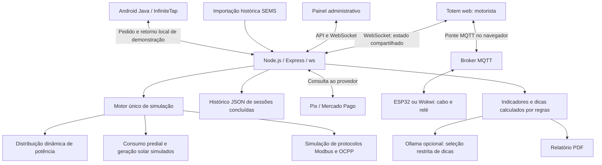
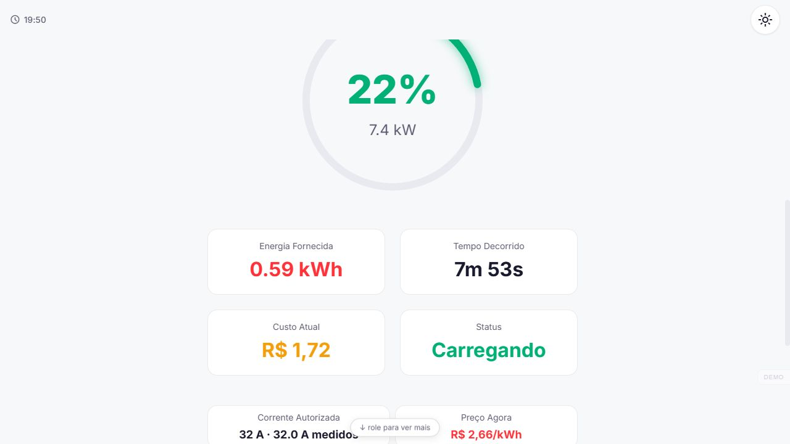
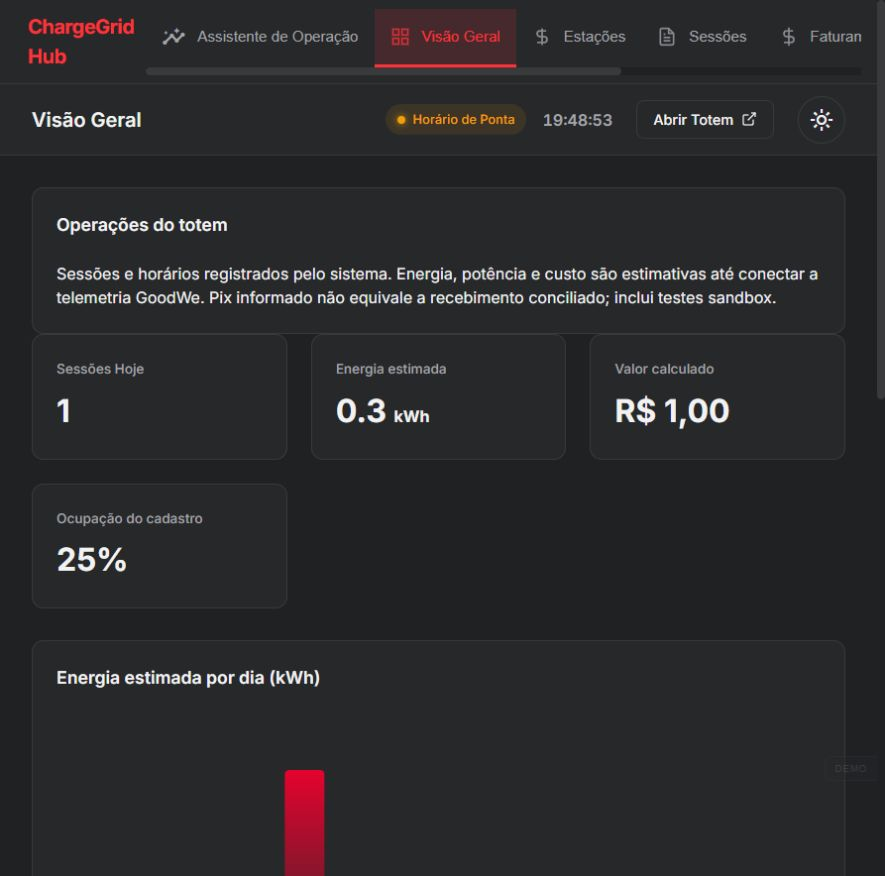
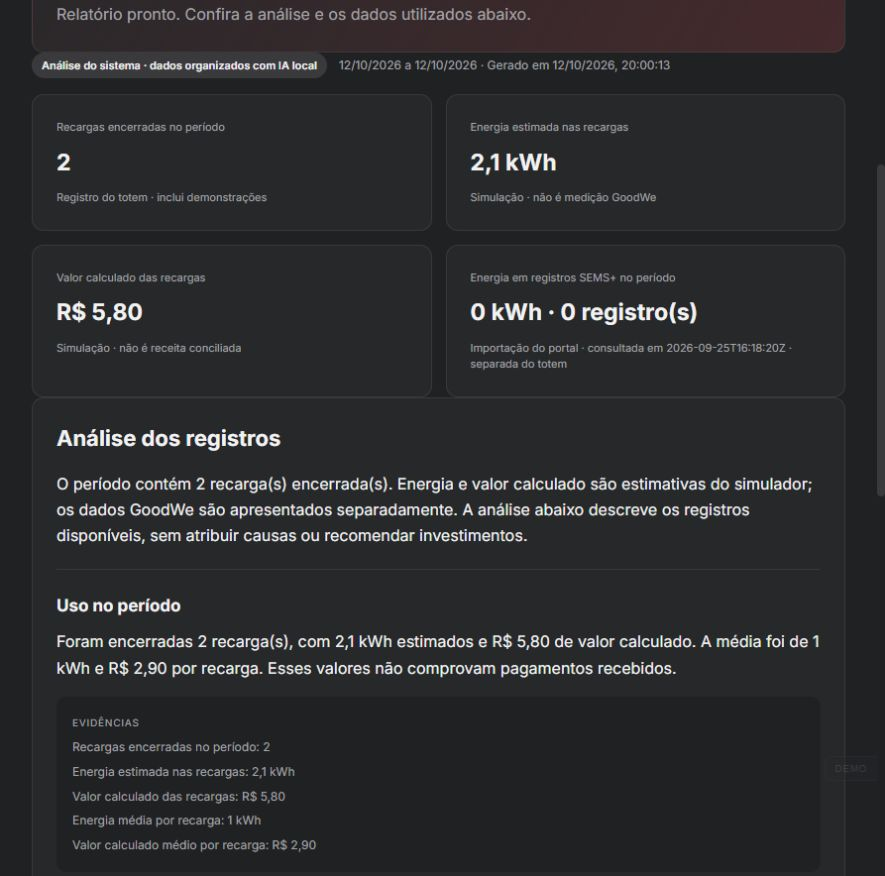

# ChargeGrid Hub — Solução Final Integrada e Inovadora GoodWe

Sprint 4 · FIAP · 23/10/2026

## Equipe

| Integrante | RM |
|---|---|
| Arthur Primo Brandão | 573572 |
| Felipe Gouveia Braga | 568956 |
| Isaías Hörlle Sobral | 568990 |
| Leandro Cavaccini Brito | 570556 |
| Lucas Dorice Dos Santos | 568692 |
| Vinicius de Oliveira Coppola | 571699 |

Repositório: https://github.com/ArthurPB25/charge-grid-hub

Relatório técnico final da Sprint 4. As conexões acadêmicas se referem aos conteúdos aplicados na implementação.

## 1. Problema, proposta e alcance da entrega

O ChargeGrid Hub é um protótipo acadêmico de gestão de eletropostos comerciais orientado ao ecossistema GoodWe. Integra a experiência do motorista, sessões concorrentes, gestão de potência, cobrança e análise administrativa em uma aplicação web. O HCA G2 é o equipamento-alvo; o protótipo não comprova integração de campo com esse carregador.

O estabelecimento precisa atender vários motoristas sem distribuir potência além da capacidade disponível, apresentar custos e acompanhar as sessões. O motorista precisa selecionar uma vaga, entender a estimativa da recarga e acompanhar seu progresso. O gestor precisa distinguir consumo estimado, registros operacionais e pagamentos, além de consultar indicadores compreensíveis.

A contribuição é a camada comercial e operacional integrada. O HCA G2 já possui recursos de controle dinâmico e uso de energia solar documentados pela GoodWe; não se reivindica a invenção desses recursos nem se pressupõe sua ausência no produto. A compatibilidade física depende do modelo, firmware, interfaces autorizadas e comissionamento.

## 2. Arquitetura final e integração



O diagrama descreve os módulos do código. As conexões a provedores dependem da configuração; as linhas não constituem evidência de execução física.

### Fluxo operacional

1. O usuário seleciona estação, veículo e forma de pagamento. O sistema informa estimativas de energia e custo.
2. O Pix consulta o Mercado Pago antes de aceitar aprovação. O InfiniteTap usa o aplicativo Android e o retorno local do provedor, tratado como evidência de demonstração, sem verificação bancária independente.
3. No fluxo Tap atual, pagar não inicia a sessão: a ação **Conectar** inicia a etapa de autorização. A ponte MQTT da estação 1 participa do fluxo legado de liberação. Falta de conexão não deve ser apresentada como carga autorizada.
4. O motor central distribui potência entre as sessões. Totem e painel recebem o mesmo estado, evitando simuladores independentes em cada tela.
5. O motor acumula energia e custo estimados. Sessões concluídas alimentam histórico, gráficos, dicas e PDF administrativo.

### Estado de implementação

| Componente | O que existe | Limite da comprovação |
|---|---|---|
| Totem e painel | HTML, CSS, JavaScript, API e WebSocket | Interface operacional do protótipo |
| Quatro estações | Sessões concorrentes no servidor | Recarga e SoC simulados |
| Energia solar e prédio | Curvas horárias e variação de nuvens | Sem medidor solar/predial ao vivo |
| Distribuição | Algoritmo com limites de veículo, estação e orçamento | Corrente calculada não comprova atuação em HCA G2 |
| Modbus/OCPP | Modelos de registradores e mensagens | Sem homologação ou interoperabilidade física demonstrada |
| ESP32 | Firmware Wi-Fi/MQTT, sensor de cabo e relé | Liga/desliga da estação 1; não regula corrente de EV |
| SEMS | Importação histórica identificada | Sem sincronização contínua |
| Pix | Integração de backend e consulta ao provedor | Credenciais e ambiente determinam se há cobrança real |
| InfiniteTap | App Android, pedido e callback | Retorno local não equivale à conciliação financeira |
| Assistente | Indicadores determinísticos e priorização opcional por Ollama | Não controla energia, preço ou pagamentos |
| Armazenamento | Histórico de sessões concluídas em JSON | Sessões ativas e pedidos voláteis; disco persistente é necessário na hospedagem |

Não há bateria estacionária integrada. A bateria do veículo é representada pelo modelo de SoC. Armazenamento estacionário e inversor físico são evoluções, não resultados desta entrega.

## 3. Controle e conceitos computacionais

Configuração de referência: demanda contratada de 75 kW, margem de 5%, quatro estações AC monofásicas de 230 V/32 A, limite de 7,36 kW por estação e perfil solar nominal de 90 kWp. São parâmetros do cenário, não uma instalação medida.

O limite operacional é `75 × (1 − 0,05) = 71,25 kW`. O orçamento instantâneo para veículos é limitado por `máximo(0; limite − consumo predial + geração solar)`. O controlador também considera energia acumulada e projeção de uma janela de demanda de 900 segundos.

O algoritmo reparte o orçamento por prioridade e redistribui a sobra quando um veículo demanda menos potência. A prioridade implementada combina 70% da urgência relativa até a meta de SoC e 30% de um fator de espera limitado a uma hora. A corrente é discretizada e considera o mínimo configurado de 6 A. Quando o orçamento não atende ao mínimo, sessões são suspensas. Reduções são imediatas; aumentos usam estabilização para reduzir oscilações. A política não possui prova formal de atendimento justo de longo prazo.

Isso é controle determinístico, não aprendizado de máquina. Decomposição, abstração, estruturas de dados, modelagem matemática e programação orientada a eventos aparecem na separação entre rede elétrica, sessão, veículo, cobrança e interface. Integração de sistemas aparece no estado centralizado e nos contratos de API. IoT aparece no firmware MQTT e na leitura do sensor de cabo.

O assistente calcula fatos antes de consultar o modelo. A opção Cloud seleciona dicas de um catálogo e uma visualização permitida; regras continuam disponíveis em caso de falha. Cache, limite de tentativas e envio de agregados reduzem chamadas e exposição de dados. Não foi medida redução energética do uso de IA.

## 4. Resultados quantitativos e método

As evidências devem ser lidas em três níveis: testes de software, resultados do cenário simulado e observações físicas registradas pelo grupo. Testes com provedores substitutos não comprovam pagamento real nem medição elétrica.

Os testes reproduzíveis estão em `server/test/energy-distribution.test.js`. Execute na raiz: `node --test server/test/energy-distribution.test.js`.

| Cenário automatizado | Resultado verificado | Significado |
|---|---|---|
| Um veículo, orçamento de 10 kW | 7,36 kW | Respeita limite da estação/veículo |
| Entrada de segundo veículo equivalente | Ambos abaixo de 7,36 kW e com potências iguais | Compartilha orçamento sem excedê-lo |
| Encerramento da primeira sessão | Outra sessão volta a 7,36 kW; energia não aumenta no ato de redistribuir | Reaproveita capacidade sem cobrar energia inexistente |
| Orçamento de apenas 1 kW | Sessão suspensa, potência zero | Não comanda corrente abaixo do mínimo configurado |
| Quatro veículos, orçamento reduzido a 3 kW | Dois pontos pausados e dois com alocação positiva | Aplica suspensão seletiva |
| Prédio em 20 kW, solar em 30 kW, um veículo | Importação da rede zero | Excedente cobre a potência da recarga |
| Mesmo cenário com dois veículos de 7,36 kW | Importação da rede de 4,72 kW | Complementa com a rede quando o solar não basta |

No último cenário, os veículos somam 14,72 kW, dos quais 10 kW podem ser atribuídos ao excedente solar pelo balanço do modelo. A participação solar instantânea é `10 / 14,72 = 67,93%`. Com essas potências constantes por uma hora, seriam 14,72 kWh para recarga, 10 kWh de excedente solar e 4,72 kWh importados. Essa extrapolação é um cálculo ilustrativo, não uma medição de uma hora.

O controle não demonstra redução da energia necessária para carregar a mesma bateria. Ele reduz ou adia a potência quando há restrição e pode aumentar o tempo de atendimento. Aproveitar excedente solar reduz importação no cenário; não prova redução equivalente da conta, pois tarifas e créditos de exportação precisam ser considerados.

A revisão de 23/10/2026 executou a suíte completa: **130 testes aprovados, zero falhas, zero ignorados**, em aproximadamente 15,5 segundos. O registro está em [testes-sprint4-2026-10-23.txt](output/auditoria/testes-sprint4-2026-10-23.txt). A execução inicial sob sandbox apresentou bloqueios de gravação e conexão; a repetição autorizada fora dessas restrições passou. Os sete testes específicos de distribuição também passaram separadamente. Os testes usam provedores controlados e não comprovam ensaios físicos, cobranças reais ou integração HCA G2.

## 5. Evidências visuais do sistema

Capturas já existentes no repositório, anteriores a esta revisão. Elas mostram o protótipo e podem diferir da versão atual. Para o vídeo final, gravar a versão efetivamente apresentada.







O diagrama acima é derivado da implementação. Não há fotografia nova de montagem física nesta revisão. Para reivindicar validação física, acrescentar imagem e registro do ensaio de cabo/relé e identificar se foi feito no Wokwi ou em bancada.

## 6. Sustentabilidade, viabilidade e avaliação crítica

**Energia renovável.** O modelo aproveita o excedente solar após o consumo do prédio. Isso demonstra uma estratégia de autoconsumo compatível com a proposta do ecossistema GoodWe, sem comprovar rendimento de um inversor instalado. Medição real exigiria instrumentação, calibração e série temporal de potência e energia.

**Pegada de carbono.** Não foi medido CO₂ evitado. A estimativa de emissões operacionais exigiria energia renovável incremental que substituiu importação e um fator de emissão identificado por fonte e período: `emissões evitadas (kg CO₂e) = energia substituída (kWh) × fator (kg CO₂e/kWh)`. Se o excedente já seria exportado e utilizado, a redução de importação local não prova benefício adicional no sistema elétrico. A fabricação dos painéis, do veículo e do hardware também não foi avaliada em ciclo de vida.

**Eficiência e infraestrutura.** A distribuição evita exceder o orçamento nos ensaios de software e aproveita sobras de estações limitadas pelo veículo. Pode contribuir para usar a capacidade existente antes de ampliar a instalação, mas não substitui projeto elétrico e proteções. Não há comprovação de economia financeira ou eliminação de desarmes em campo.

**Relevância social e operacional.** O totem compartilhado atende vários usuários, fornece estimativas e permite ao gestor acompanhar sessões. Esses benefícios são observáveis na interface, mas faltam ensaios de usabilidade, acessibilidade e satisfação. Pagamento não torna a solução acessível a todos; meios alternativos e suporte precisam ser avaliados.

**Inovação.** O diferencial está na composição do fluxo comercial, controle multiestação, visualização e assistente com fatos verificáveis. A IA é restrita à análise administrativa; falhas do modelo não devem controlar cargas. Não se reivindica novidade científica dos algoritmos ou protocolos.

**Viabilidade.** O software usa tecnologias acessíveis e pode ser executado com Node.js. O ESP32 demonstra uma ponte IoT de baixo custo. Não existe orçamento validado de instalação, retorno do investimento ou comparação econômica. Antes de uso comercial, são necessários autenticação e autorização completas, MQTT privado/autenticado, persistência durável, conciliação de pagamentos, medição adequada e validação elétrica. O relé do protótipo não deve ser tratado como equipamento de potência homologado para recarga.

**Evolução em relação à proposta inicial.** Documentos antigos citam Python como backend, LangChain, Assembly, E-ink, deep sleep e sensores de presença. Esses itens não representam a aplicação web final examinada. O backend atual é JavaScript/Node.js e o app Android é Java. Não foram comprovados E-ink, deep sleep, assistente por voz ou redução de consumo ocioso. Preço é calculado por regras; o solar afeta potência, não a tarifa atual.

## 7. Aderência à avaliação

| Critério | Evidência apresentada |
|---|---|
| Solução integrada e inovadora — até 60 | Totem e painel sincronizados, sessões concorrentes, redistribuição e suspensão, pagamento, histórico e assistente; vídeo deve demonstrar o fluxo |
| Alinhamento GoodWe/disciplina — até 25 | Equipamento-alvo HCA G2, autoconsumo solar, limites de demanda, integração IoT e relação entre abstração, eventos, controle e sustentabilidade |
| Organização — até 15 | Código, relatório técnico principal, capturas e testes organizados no repositório |

Esta matriz identifica evidências; não garante pontuação. A demonstração física e a integração direta com equipamentos permanecem limitadas ao que o grupo efetivamente gravar e comprovar.

## 8. Referências e rastreabilidade

Referências GoodWe consultadas em 23/10/2026:

- [HCA G2 — recursos oficiais](https://emea.goodwe.com/hca-g2): uso de solar e controle dinâmico nativos; o projeto complementa a operação comercial.
- [SEMS — monitoramento oficial](https://en.goodwe.com/sems-series-smart-energy-management-system): referência para monitoramento; a implementação atual importa dados históricos.

Fontes do código e ferramentas:

- [Configuração do cenário](data/site-config.js), [balanço elétrico](server/sim/site.js), [controlador](server/sim/demand.js) e [sessões](server/sim/session.js).
- [Motor compartilhado](server/sim/engine.js), [WebSocket](server/ws.js) e [testes de distribuição](server/test/energy-distribution.test.js).
- [Firmware ESP32 e sensor de cabo](esp32/chargegrid-rele.ino), com WiFi e PubSubClient; a ponte MQTT e seus limites são descritos na arquitetura deste relatório.
- [Dependências e versões declaradas](server/package.json) e lockfile: Express, ws, dotenv, cors e PDFKit. Interfaces em HTML/CSS/JavaScript; Android em Java.
- [Assistente administrativo](server/cloud-advisor.js), [histórico](server/totem-history.js), [importação SEMS](server/sems-import.js), [InfiniteTap](server/tap-demo.js) e [instruções de execução](#executar-localmente).
- Documentação oficial das ferramentas: [Node.js](https://nodejs.org/docs/latest-v22.x/api/), [Express](https://expressjs.com/), [ws](https://github.com/websockets/ws), [PDFKit](https://pdfkit.org/), [Ollama](https://docs.ollama.com/), [PubSubClient](https://pubsubclient.knolleary.net/).

## 9. Material e entrega

Este README reúne o relatório final e a documentação principal do projeto, conforme a opção de entrega pelo repositório. O vídeo técnico deve demonstrar a solução em até cinco minutos. O único arquivo a enviar no portal é o `.txt` com nomes, RMs, vídeo não listado e GitHub. O vídeo ainda precisa ser gravado e publicado pelo grupo.

## Executar localmente

Pré-requisito: **Node.js 22 com npm**. Execute na raiz do repositório:

```powershell
npm ci --prefix server
if (-not (Test-Path server/.env)) {
    Copy-Item server/.env.example server/.env
}
npm start --prefix server
```

Crie `server/.env` apenas se ainda não existir e ajuste as opções a partir do exemplo. O padrão de referência é a porta 3001; use a porta configurada no ambiente:

- Totem: http://localhost:3001/
- Painel: http://localhost:3001/admin.html
- Saúde: http://localhost:3001/healthz

`AI_PROVIDER=rules` permite relatórios sem consultar modelos. Ollama local e Cloud são opcionais, conforme `server/.env.example`. As credenciais ficam no backend e não devem ser versionadas.

Pix exige credenciais apropriadas: `MP_SANDBOX=true` não transforma uma credencial de produção em credencial de teste. InfiniteTap requer aplicativo Android e configuração do terminal; a demonstração pode envolver cobrança real de R$1. A energia estimada da sessão é contabilizada separadamente. Não é necessário realizar cobranças para executar os testes automatizados.

## Verificar e demonstrar

```powershell
node --test server/test/*.test.js
```

Resultado da revisão de 23/10/2026: **130 testes aprovados, nenhuma falha**, usando provedores controlados. Veja o [registro da execução](output/auditoria/testes-sprint4-2026-10-23.txt).

Para demonstrar o controlador, prepare duas ou mais sessões, abra o painel e use **Modo demonstração → Pico moderado / Pico severo**, seguido de **Normalizar consumo**. Observe a repartição e as suspensões. No fluxo legado, a autorização depende de MQTT; o tópico compartilhado pode acionar um ESP32 inscrito. O teste interativo deve usar a bancada prevista pelo grupo.

A referência comercial de preço-base é R$2,00/kWh. Os fatores de horário e ocupação são regras do projeto; não representam a tarifa de uma distribuidora. O preço aceito no pedido é preservado na sessão. Solar e restrição de rede afetam potência, sem mudar o preço.
